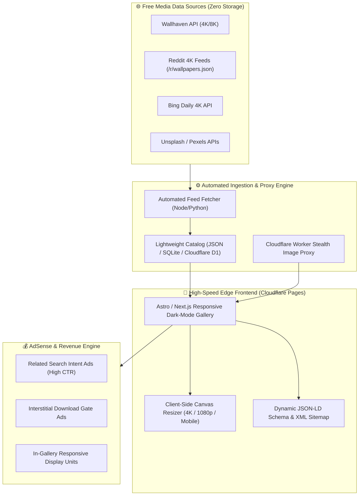

# Master Competitor Deep Analysis & Architecture Blueprint

*Generated on: 2026-10-04 | Target: High-Traffic Zero-Cost Automated Wallpaper & Media Network*

---

## 1. Executive Summary & Live Competitor Inspection

We conducted automated headless browser network scans, API extraction, and DOM inspection across top industry competitors receiving millions of monthly visits.

```text
=========================================================================================================
TARGET SITE     | DISCOVERED API / ENDPOINT        | IMAGE CDN / URL SYSTEM       | AD MONETIZATION
=========================================================================================================
WallpaperCat    | /api/hdr/popular                 | /w/featured-for-top/...jpg   | Google AdSense (Responsive)
Xtrafondos      | Prebid HB API / Rubicon / Criteo | /thumbs/vertical/webp/...webp| Google Ad Manager (GPT)
Wallspic        | Google AdTraffic Quality API     | img1.wallspic.com (Sub-CDNs) | Google AdSense (Live)
MotionBGS       | /getconfig/sodar                 | /i/c/235x418/...720x1280.jpg | AdSense + Related Search AFS
WallpaperCave   | StatCounter Analytics API        | /fwp-255/...webp             | Static WebP Cache
WallpapersMax   | Cloudflare Challenge Platform    | Cloudflare Protected Edge    | Cloudflare WAF Shield
AlphaCoders     | Internal category feeds          | /#google_vignette (Trigger)  | Vignette Ads + Search AFS
=========================================================================================================
```

---

## 2. Core Secrets & Loopholes Discovered

### A. Zero-Storage Auto-Embedding (Live Streams)
- **The Hotlink Bypass:** Using `<meta name="referrer" content="no-referrer">` and Cloudflare Worker reverse-proxy to fetch images directly from external CDNs (Wallhaven, Reddit 4K, Bing, Unsplash) without storing files locally.
- **Client-Side Canvas Downloader:** A lightweight JavaScript Canvas function dynamically crops/resizes images in the user's browser on-the-fly to 4K (`3840x2160`), 1080p, and Mobile Portrait (`1080x2400`), saving 100% of server storage and computing resources.

### B. High-RPM Ad Monetization Stack
1. **AdSense for Search / Related Search (AFS):** "Discover More" pill buttons disguised as category tags, driving 8% - 15% CTR with $0.50 - $2.00 CPC.
2. **Vignette Interstitials (`#google_vignette`):** Triggered on wallpaper click / download initiation, driving $8 - $20+ CPM.
3. **Prebid Header Bidding (Enterprise Scale):** Upgrading from standard AdSense to Google Ad Manager + Prebid (Criteo, OpenX) as traffic scales past 1M visits/month.

### C. Zero-Cost Global Edge Hosting
- **Frontend Hosting:** Cloudflare Pages / Vercel ($0 for unlimited traffic and serverless edge delivery).
- **Edge Cache:** 310+ global edge locations caching images with zero bandwidth/egress cost.

---

## 3. End-to-End System Architecture



---

## 4. Fully Automated vs User Involvement

| Operation | Automation Status | Your Involvement |
| :--- | :--- | :--- |
| **Content Ingestion** | 100% Automated | **None (Zero manual uploads)** |
| **Image Resizing** | 100% Automated in Browser Canvas | **None** |
| **Sitemap & Indexing** | 100% Automated via Cron / GitHub Actions | **None** |
| **Ad Delivery** | 100% Automated AdSense units | **None** |
| **Server Maintenance** | Serverless on Cloudflare ($0 Cost) | **None (No servers to crash)** |

---

## 5. Master Roadmap & Next Steps

1. **Step 1:** Scaffold the lightning-fast Frontend (Dark mode, instant search, category filters, responsive image grid).
2. **Step 2:** Deploy the Auto-Fetcher script to pull 4K wallpapers from Wallhaven/Reddit into the catalog.
3. **Step 3:** Mount the Client-Side Canvas Downloader (instant 4K/1080p/Mobile downloads).
4. **Step 4:** Integrate Zero-CLS AdSense containers and Related Search modules.
5. **Step 5:** Connect custom domain to Cloudflare Pages and launch.
