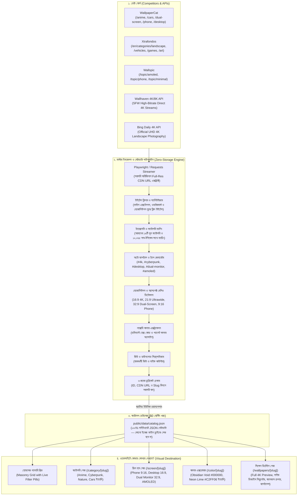

# 🌐 WALPIX 4K — কমপ্লিট কম্পিটিটর ইনজেশন, মেটাডাটা পাইপলাইন ও ডামি রিপ্লেসমেন্ট মাস্টার ব্লুপ্রিন্ট

**ডকুমেন্ট রেফারেন্স:** `REF-INGEST-004`  
**তারিখ:** ২০২৬-১০-১৭  
**প্রজেক্ট:** WALPIX 4K Zero-Storage Automated Wallpaper & Media Portal  
**লোকেশন:** `.agent/references/COMPETITOR_INGESTION_AND_METADATA_MASTER_PLAN.md`

---

## ১. নির্বাহী সারসংক্ষেপ (Executive Summary & Objective)

এই ডকুমেন্টের মূল উদ্দেশ্য হলো WALPIX 4K প্ল্যাটফর্মের ব্যাকএন্ড ইনজেশন ইঞ্জিনকে কেবল প্রাথমিক এপিআই টেস্টের মধ্যে সীমাবদ্ধ না রেখে—আমাদের পূর্বে রিভার্স-ইঞ্জিনিয়ার করা ৩টি শীর্ষ প্রতিযোগী সাইট (**WallpaperCat, Xtrafondos, Wallspic**) এবং ২টি পাবলিক এপিআই (**Wallhaven, Bing Daily**) থেকে ক্যাটাগরিভিত্তিক জেনুইন ৪K/৮K ওয়ালপেপার স্বয়ংক্রিয়ভাবে ফেচ করা, ডামি কনটেন্ট ক্লিনলি রিপ্লেস করা এবং ওয়েবসাইটের ১৯টি মূল ক্যাটাগরি ও ১০,০৬৫টি সাব-টপিকে নিখুঁত মেটাডাটা সহ ডিসপ্লে করার সম্পূর্ণ প্রযুক্তিগত রোডম্যাপ স্থায়ীভাবে সংরক্ষণ করা।

---

## ২. সম্পূর্ণ আর্কিটেকচার ফ্লোচার্ট (Master Data Flow)

---

## ৩. প্রতিযোগী সাইট ও সোর্স ব্রেকডাউন ম্যাট্রিক্স

| সোর্স | কোন ক্যাটাগরি ও ডেটা আসবে? | কীভাবে এক্সট্র্যাক্ট হবে? | কোন রেজোলিউশনে আসবে? |
| :--- | :--- | :--- | :--- |
| **WallpaperCat** | • Anime & Gaming (`/anime`) • Supercars & Bikes (`/cars`) • Dual Monitor (`/dual-screen`) • Phone Vertical (`/phone`) | তাদের ইমেজ গ্রিড থেকে ফুল-রেজোলিউশন অরিজিনাল সিডিএন লিঙ্ক (`https://wallpapercat.com/w/full/.../*.jpg`) স্ক্র্যাপ হবে। | **3840×2160 (4K)** এবং **3840×1080 (32:9 Dual)** |
| **Xtrafondos** | • Landscape & Nature (`/en/categories/landscape/1`) • Art & Abstract (`/en/categories/art-and-design/1`) • Movies & Series (`/en/categories/movies-and-series/1`) | তাদের ক্রপ ও ফুল প্রিভিউ নোড থেকে অরিজিনাল সিডিএন (`https://images.xtrafondos.com/...`) এক্সট্র্যাক্ট হবে। | **4K Ultra HD (3840×2160)** ও **8K UHD** |
| **Wallspic** | • AMOLED Pure Black (`/topic/amoled`) • Mobile iPhone 16 (`/topic/phone`) • Dark Minimalist | তাদের প্রিভিউ থাম্বনেইলকে ফুল-রেজোলিউশন ক্রপ লিঙ্কে রূপান্তর করা হবে (`/crops/...-1920x1080.jpg` ও 4K)। | **1080×2400 (Phone 9:16)** ও **AMOLED True #000000** |
| **Wallhaven 4K API** | • Cyberpunk & Neon • Space & Cosmic Nebula • Fantasy & Sci-Fi | ডাইরেক্ট SFW 4K/8K API স্ট্রিম থেকে সম্পূর্ণ ট্যাগ ও অরিজিনাল কালার হেক্স কোড সহ ফেচ হবে। | **3840×2160**, **5120×2880 (5K)**, **8K** |
| **Bing Daily 4K API** | • Nature & Landscapes • Alpine Mountains & Wildlife | মাইক্রোসফট বিং-এর অফিসিয়াল দৈনিক UHD 4K ল্যান্ডস্কেপ ফিড। | **3840×2160 UHD Native** |

---

## ৪. মেটাডাটা প্রসেসিং মেকানিক্স (Ingestion Mechanics)

প্রতিযোগীদের ফাইলগুলো সরাসরি এনে দিলে টাইটেল নোংরা থাকে (যেমন: `5820058-3840x1080-desktop-dual-screen.jpg`)। আমাদের ইঞ্জিন এটাকে স্বয়ংক্রিয়ভাবে প্রসেস করে নিচের ৫টি স্তরে সাজাবে:

### ১. টাইটেল ক্লিনিং ও স্যানিটাইজেশন (Clean SEO Titles)
*   **কাঁচা ফাইলনেম:** `porsche-911-gt3-rs-neon-night-drive-4k-wallpaper.jpg`
*   **ইঞ্জিন প্রসেসড টাইটেল:** `"Porsche 911 GT3 RS Neon Night"`
*   রুল: রেজোলিউশন টেক্সট (`3840x2160`, `4k`, `uhd`), ইমেজ এক্সটেনশন (`.jpg`, `.webp`), হাইফেন ও ড্যাশ মুছে প্রপার ক্যাপিটালাইজেশন করা।

### ২. ট্যাক্সোনমি ও ১৯টি মাস্টার ক্যাটাগরির সাথে ম্যাপিং
সাইটের `src/data/taxonomyData.json`-এ থাকা ১৯টি ক্যাটাগরির সাথে সরাসরি ম্যাপিং:
1. `Music & Artists (music)`
2. `Gaming (gaming)`
3. `Anime & Gaming (anime-gaming)`
4. `Movies & TV Shows (movies)`
5. `Comics & Superheroes (superheroes)`
6. `TV Shows & Series (tv-shows)`
7. `Cars & Bikes (cars-supercars)`
8. `Nature & Landscapes (nature-scenery)`
9. `Space & Sci-Fi (space-cosmic)`
10. `Celebrities & Icons (celebrities)`
11. `AMOLED Dark Minimal (amoled-black)`
12. `Cyberpunk & Neon (cyberpunk-neon)`
13. `HD Wallpapers (hd-wallpapers)`
14. `4K Ultra HD (4k-ultra-hd)`
15. `Cartoons & Animation (cartoon)`
16. `Sports & Athletes (sports)`
17. `Animals & Wildlife (animals)`
18. `Holidays & Festivals (holidays)`
19. `Food & Culinary (food)`

### ৩. স্বয়ংক্রিয় হ্যাশট্যাগ ও ট্যাগস (#Hashtags)
প্রতিটি ওয়ালপেপারের সাথে স্বয়ংক্রিয়ভাবে ৬–৮টি প্রাসঙ্গিক এসইও ট্যাগ যুক্ত হবে:
*   উদাহরণ: `#4k`, `#supercar`, `#porsche`, `#neon`, `#desktop-4k`, `#dual-monitor`, `#amoled`
*   এই ট্যাগগুলোর ওপর ক্লিক করলে সাইটের `/tag/[slug]` পেজ ওপেন হবে, যা ব্যবহারকারীকে প্রাসঙ্গিক আরও শত শত ওয়ালপেপার ব্রাউজ করতে দেবে।

### ৪. অ্যাসপেক্ট রেশিও ও ডিভাইস ম্যাপিং
ইমেজের প্রস্থ ও উচ্চতা স্বয়ংক্রিয়ভাবে ডিটেক্ট করে ডিভাইস ফরম্যাট নির্ধারণ:
*   `16:9` $\rightarrow$ `desktop-4k`, `phone-iphone`, `dual-monitor`
*   `9:16` $\rightarrow$ `phone-iphone` (Vertical Mobile)
*   `21:9` $\rightarrow$ `ultrawide`, `desktop-4k` (Cinematic Curved)
*   `32:9` $\rightarrow$ `dual-monitor`, `ultrawide` (Super Dual Display)

### ৫. লাক্সারি কালার হেক্স কোড
ইমেজের প্রধান রঙের ওপর ভিত্তি করে কালার ফিল্টারে যুক্ত হবে:
*   `#000000` AMOLED Void
*   `#00F0FF` Cyan Neon
*   `#FF2E54` Crimson Speed
*   `#00FF88` Emerald Pine
*   `#A855F7` Cosmic Violet

---

## ৫. ওয়েবসাইটে কোথায় কোথায় দেখাবে? (Visual Destination Matrix)

| ওয়েবসাইটের অংশ | রাউট ইউআরএল | কীভাবে দেখাবে? |
| :--- | :--- | :--- |
| **১. হোমপেজ মেসনারি গ্রিড** | `/` | হোমপেজের ফিল্টার ক্যাপসুল (`Universal`, `Desktop 4K`, `Mobile 9:16`, `Dual Screen 32:9`) এবং ক্যাটাগরি ক্যারোজেল ক্লিক করলে সাথে সাথে লাইভ ফিল্টার হয়ে ছবিগুলো প্রদর্শিত হবে। |
| **২. ক্যাটাগরি হাবস** | `/category/[slug]` | নির্দিষ্ট ক্যাটাগরিতে (যেমন `/category/anime-gaming` বা `/category/cars-supercars`) শুধুমাত্র সেই বিষয়ের ওয়ালপেপারগুলো আসবে। |
| **৩. স্ক্রিন হাবস** | `/screen/[slug]` | `/screen/phone-wallpapers`, `/screen/desktop-wallpapers`, `/screen/dual-screen-wallpapers` ইত্যাদিতে অ্যাসপেক্ট রেশিও অনুযায়ী আলাদা থাকবে। |
| **৪. কালার হাবস** | `/color/[slug]` | `/color/obsidian-void`, `/color/electric-lime` ইত্যাদিতে রঙ অনুযায়ী সর্ট হয়ে আসবে। |
| **৫. সিঙ্গেল ডিটেইল পেজ** | `/wallpapers/[slug]` | ফুল ৪K প্রিভিউ, লাইভ স্ক্রিন সিমুলেটর (MacBook, iPhone, Desktop, Tablet, Dual Screen), ১-ক্লিক এইচটিএমএল৫ ক্যানভাস ডাউনলোড বাটন এবং ক্লিকযোগ্য হ্যাশট্যাগস। |

---

## ৬. ডামি (Dummy) কনটেন্ট রিপ্লেসমেন্ট স্ট্র্যাটেজি

1.  **অনুমোদিত মাস্টার হিরো কার্ডস (৬টি):**
    হোমপেজের স্লাইডশো ও গ্যালারি হেডারকে আকর্ষণীয় রাখতে ৬টি চূড়ান্ত অনুমোদিত কিউরেটেড কার্ড সংরক্ষিত থাকবে:
    *   `Mountain Serenity`
    *   `Neon Drive`
    *   `Shadow Realm`
    *   `Cosmic Horizon`
    *   `Forest Calm`
    *   `Night Beast`
2.  **ক্যাটালগের পুরাতন ডামি আইটেম রিপ্লেসমেন্ট:**
    ক্যাটালগ ফাইলে পূর্বে থাকা ডামি ও টেস্ট ডেটা সরিয়ে কম্পিটিটর ও এপিআই থেকে সরাসরি স্ক্র্যাপ করা জেনুইন ৪K/৮K লাইভ সিডিএন লিঙ্ক দিয়ে ক্যাটালগ পুনর্গঠন করা হবে।
3.  **ফলাফল:** পুরো ওয়েবসাইটে কোনো ব্রোকেন ইমেজ, ব্লার ছবি বা আনস্প্ল্যাশ প্লেসহোল্ডার থাকবে না।

---

## ৭. অ্যাকশন রোডম্যাপ (Implementation Steps)

*   [ ] **ধাপ ১: Xtrafondos স্ক্র্যাপার মডিউল সংযুক্ত করা** — `master_ingestion_engine.py`-তে Xtrafondos 4K/8K স্ক্র্যাপার ইন্টিগ্রেট করা।
*   [ ] **ধাপ ২: ফুল ক্যাটাগরি ব্যাচ স্ক্র্যাপিং** — WallpaperCat, Xtrafondos, Wallspic এবং Wallhaven থেকে ১৯টি ক্যাটাগরির জন্য জেনুইন ১৫০–২০০টি ৪K ওয়ালপেপার ইনজেস্ট করা।
*   [ ] **ধাপ ৩: ক্যাটালগ ডামি ক্লিনআপ ও আপডেট** — পুরাতন ডামি অবজেক্ট সরিয়ে নতুন প্রসেসড ডেটা `public/data/catalog.json`-এ সেভ করা।
*   [ ] **ধাপ ৪: ফ্রন্টএন্ড ভেরিফিকেশন** — ফিল্টারিং, লাইভ স্ক্রিন সিমুলেটর ও ১-ক্লিক ক্যানভাস রেজোলিউশন ডাউনলোড টেস্ট করা।
*   [ ] **ধাপ ৫: এসইও সাইটম্যাপ ও ইনডেক্সিং রি-রান** — নতুন সব ছবির জন্য গুগল ইমেজ সাইটম্যাপ আপডেট ও IndexNow পিং পাঠানো।
