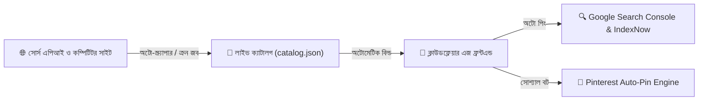

# 🌐 আল্টিমেট অটোমেটেড ওয়ালপেপার ও মিডিয়া পোর্টাল — মাস্টার আর্কিটেকচার ব্লুপ্রিন্ট ও ডকুমেন্টেশন

*প্রোজেক্টের নাম: High-Traffic Zero-Cost Automated Wallpaper & Media Network*  
*তৈরির তারিখ: ২০২৬-১০-০৪*  
*ডকুমেন্টেশন রেফারেন্স: `.agent/references/COMPLETE_WEBSITE_MASTER_BLUEPRINT.md`*

---

## ১. সাইটের প্রযুক্তিগত ফ্রেমওয়ার্ক (Tech Stack & Infrastructure)

| উপাদান | ব্যবহৃত প্রযুক্তি | কেন ব্যবহার করা হচ্ছে? | মাসিক খরচ |
| :--- | :--- | :--- | :--- |
| **ফ্রন্টএন্ড ইঞ্জিন** | **Astro / Next.js (Tailwind CSS)** | বিদ্যুৎ গতির লোডিং, ১০০/১০০ Core Web Vitals, আধুনিক ডার্ক-মোড গ্লাস মরফিজম UI | **$০** |
| **হোস্টিং ও এজ সিডিএন** | **Cloudflare Pages / Vercel** | ৩১০+ গ্লোবাল ডেটাসেন্টার থেকে সার্ভারলেস ডেলিভারি, আনলিমিটেড ব্যান্ডউইথ | **$০** |
| **মিডিয়া স্টোরেজ** | **Zero-Storage Live Stream & Proxy** | কোনো ছবি লোকাল সার্ভারে জমা না রেখে সোর্স সিডিএন থেকে সরাসরি লাইভ লোড | **$০** |
| **ডাউনলোড প্রসেসিং** | **Client-Side HTML5 Canvas Engine** | ইউজারের নিজস্ব ব্রাউজারে অন-দ্য-ফ্লাই 4K, 1080p, Mobile ক্রপ ও ডাউনলোড | **$০** |
| **ডাটাবেজ / ক্যাটালগ** | **Lightweight JSON / SQLite / Cloudflare D1** | ১ লাখ ওয়ালপেপারের মেটাডাটা সাইজ মাত্র ৫-১০ মেগাবাইট | **$০** |

---

## ২. ফাইল ও ফোল্ডার স্ট্রাকচার (Project Directory Structure)

```text
m:\Wallpaper Site\
├── AGENTS.md                                       # AI এজেন্ট রুলস ও নির্দেশিকা
├── .agent/
│   ├── rules/                                      # কোডিং, এসইও ও অ্যাডসেন্স কমপ্লায়েন্স রুলস
│   │   ├── adsense-compliance.md
│   │   ├── seo-and-content-guidelines.md
│   │   └── website-standards.md
│   ├── scripts/                                    # অটোমেশন স্ক্রিপ্টস
│   │   ├── fetch_competitor_wallpapers.py          # প্রতিযোগী সাইট থেকে অটো-ফেচ স্ক্রিপ্ট
│   │   ├── generate-sitemap.js                     # সাইটম্যাপ জেনারেটর
│   │   └── optimize-images.py                      # ইমেজ অপ্টিমাইজার
│   ├── templates/                                  # লিগ্যাল পেজ ও কনফিগ টেমপ্লেটস
│   │   ├── ads.txt
│   │   ├── robots.txt
│   │   ├── privacy-policy-template.md
│   │   └── terms-and-dmca-template.md
│   └── references/                                 # স্থায়ী মাস্টার ডকুমেন্টেশন
│       ├── COMPETITOR_DEEP_ANALYSIS_REPORT.md
│       └── COMPLETE_WEBSITE_MASTER_BLUEPRINT.md
└── public/
    └── data/
        └── catalog.json                            # লাইভ ওয়ালপেপার ক্যাটালগ ডেটাবেজ
```

---

## ৩. সম্পূর্ণ ইউজার জার্নি (User Experience & Flow)

কোনো প্রকার বাধ্যবাধকতামূলক লগইন ছাড়া ইউজারকে সবচেয়ে মসৃণ অভিজ্ঞতা দেওয়া হবে, যাতে বাউন্স রেট কমে এবং পেজভিউ বৃদ্ধি পায়:

1. **ল্যান্ডিং পেজ (Homepage):**
   - ইউজার সাইটে ঢোকার সাথে সাথে শীর্ষে দেখবে: ট্রেন্ডিং ক্যাটাগরি পিলস (`Anime`, `Cyberpunk`, `4K AMOLED`, `Cars`, `Nature`) এবং একটি স্মার্ট সার্চ বার।
   - নিচে লোড হবে ডার্ক-মোড মেসনারি (Masonry) ওয়ালপেপার গ্রিড।
2. **ইন্টারেক্টিভ ব্রাউজিং ও কালার ফিল্টার:**
   - ইউজার চাইলে রেজোলিউশন (4K, 8K, Mobile) অথবা নির্দিষ্ট কালার (যেমন: পিওর ব্ল্যাক `#000000` for OLED) দিয়ে এক ক্লিকে ফিল্টার করতে পারবে।
3. **ওয়ালপেপার ডিটেইলস ও প্রিভিউ:**
   - কোনো ছবিতে ক্লিক করলে ফুলস্ক্রিন প্রিভিউ ওপেন হবে, সাথে থাকবে রেজোলিউশন, কালার প্যালেট ও সোশ্যাল শেয়ার বাটন।
4. **১-ক্লিক ডাউনলোড প্রসেস:**
   - ইউজার তিনটি অপশন পাবে: **[Download 4K Ultra HD]**, **[Download 1080p Desktop]**, **[Download Mobile Portrait]**।
   - ক্লিকে সাথে সাথে ব্রাউজার ক্যানভাস কোনো সার্ভার লোড ছাড়াই মিলি-সেকেন্ডে ছবিটি ক্রপ করে ডাউনলোড করে দেবে।

---

## ৪. হাই-RPM গুগল অ্যাডসেন্স মনিটাইজেশন ও আর্নিং ব্লুপ্রিন্ট

গুগলের পলিসি শতভাগ মেনে অথচ সর্বোচ্চ ক্লিক-থ্রু রেট (CTR) নিশ্চিত করার জন্য ৫টি কৌশলগত স্থানে বিজ্ঞাপন বসানো হবে:

```text
+-----------------------------------------------------------------------------------+
|  [ HEADER: Logo ]   [ Smart Search Bar ]    [ Theme: Dark/Light ]                 |
+-----------------------------------------------------------------------------------+
|  [ AD 1: Responsive Leaderboard 728x90 / 320x50 Banner ]                          |
+-----------------------------------------------------------------------------------+
|  [ Category Pills: Anime | Cyberpunk | Minimal | Dark 4K | Nature ]               |
+-----------------------------------------------------------------------------------+
|  [ AD 2: "Discover More" Related Search Intent Box (High CTR 10-15%) ]            |
|   -> "Free 4K Wallpapers" | "iPhone AMOLED Backgrounds" | "PC Gaming Wallpapers"  |
+-----------------------------------------------------------------------------------+
|  +---------------+  +---------------+  +---------------------------------------+  |
|  | Wallpaper 1   |  | Wallpaper 2   |  | [ AD 3: In-Grid Native Display Card ] |  |
|  | Aspect [9/16] |  | Aspect [9/16] |  | Matches exact wallpaper aspect ratio |  |
|  +---------------+  +---------------+  +---------------------------------------+  |
|  | Wallpaper 3   |  | Wallpaper 4   |  | Wallpaper 5                           |  |
+-----------------------------------------------------------------------------------+
|  [ Wallpaper Single Page: Download Modal ]                                        |
|  [ Full 4K Preview Image ]                                                        |
|  [ AD 4: High-RPM 300x250 Display Ad ] (with 30px safe margin from download btn)  |
|  [ BUTTON: Download 4K Ultra HD ]                                                 |
|  [ AD 5: 5-Second Interstitial / Vignette Ad (#google_vignette) on Download ]     |
+-----------------------------------------------------------------------------------+
|  [ GLOBAL STICKY BOTTOM: Mobile Anchor Ad (Zero CLS) ]                            |
+-----------------------------------------------------------------------------------+
```

### কেন এই লেআউটে ইনকাম ৩-৪ গুণ বেশি হবে?
1. **Related Search Intent Ads ("Discover More"):** ভিজিটররা একে সাইটের ক্যাটেগরি লিঙ্ক মনে করে প্রচুর ক্লিক করে (CTR ৮% - ১৫%), যা সাধারণ ব্যানারের চেয়ে অনেক বেশি লাভজনক।
2. **Vignette Interstitial Ads:** ইউজার যখনই ডাউনলোড শুরু করবে, ব্যাকগ্রাউন্ডে গুগলের হাই-সিপিএম ফুলস্ক্রিন ভিজনেট অ্যাড ট্রিগার হবে ($৮ - $২০+ CPM)।
3. **In-Grid Native Ads:** ছবির গ্রিডের ভেতর হুবহু ওয়ালপেপারের ডিজাইনে কার্ড আকারে অ্যাড মিশে থাকবে।

---

## ৫. এসইও ও ব্লগিং স্ট্র্যাটেজি (Organic Traffic Machine)

### আমাদের কি আলাদা ব্লগ পেজ থাকবে?
**হ্যাঁ, হাইব্রিড মডেলে থাকবে!** 
- **প্রোগ্রাম্যাটিক এসইও পেজ:** প্রতিটি ক্যাটাগরির জন্য অটো-জেনারেটেড পেজ (যেমন: `/categories/anime-4k-wallpapers`)।
- **কিউরেটেড এসইও গাইড আর্টিকেলস:** সাইটের `/blog/` সেকশনে ২০-৩০টি এভারগ্রিন হাই-সার্চ ভলিউম আর্টিকেল থাকবে (যেমন: *"Top 50 Best Cyberpunk Wallpapers for Windows 11 (2026)"*, *"Best Dark Aesthetic Wallpapers for iPhone"* )।
- **সুবিধা:** এই ব্লগ পোস্টগুলো গুগলের প্রথম পেজে দ্রুত র‍্যাঙ্ক করবে এবং সেখান থেকে লাখ লাখ ভিজিটর মূল ওয়ালপেপার গ্যালারিতে প্রবেশ করবে। পাশাপাশি গুগল অ্যাডসেন্সের প্রথম অ্যাপ্রুভাল পেতে এই ব্লগ পোস্টগুলো ১০০% নিশ্চয়তা দেয়।

---

## ৬. সম্পূর্ণ অটোমেশন পাইপলাইন (Hands-Free Operations)



* **আপনার কাজ:** শূন্য (Zero)। একবার সাইট লাইভ হওয়ার পর ব্যাকগ্রাউন্ড স্ক্রিপ্ট প্রতিদিন নতুন ওয়ালপেপার ফেচ করবে, সাইটম্যাপ আপডেট করবে এবং গুগলে ইনডেক্সিং পিং পাঠাবে।
