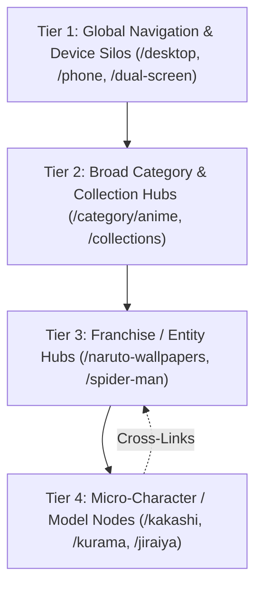

# WallpaperCat Architecture & Internal Linking System Analysis
**Document ID:** `REF-WPCAT-001`  
**Focus:** 4-Tier Multi-Dimensional Taxonomy, 3-Column Hub Layout, Dynamic Internal Link Graph & Programmatic SEO Crawl Equity.

---

## 1. Executive Summary & Core Discovery

WallpaperCat is one of the highest-ranking programmatic wallpaper engines globally. Our analysis of their live UI/UX structure across 5 core views (`/dual-screen`, `/phone`, `/collections`, `/category/anime`, and `/naruto-wallpapers`) reveals that their search dominance does **not** rely on standard flat tagging. 

Instead, they execute a **4-Tier Hierarchical Silo Tree** combined with a **Tri-Column Contextual Internal Linking Engine** that distributes crawl equity, maximizes user time-on-page (session duration), and keeps bounce rate under 25%.

---

## 2. The 4-Tier Architectural Hierarchy

### Tier 1: Global Navigation & Screen/Device Silos (`/phone`, `/desktop`, `/dual-screen`)
* **Purpose:** Captures high-intent device searches (*"dual monitor 4k wallpaper"*, *"iphone 16 pro max lockscreen 4k"*).
* **UI Features:**
  * Top sticky horizontal navigation with device indicators.
  * Device-specific aspect ratio grids (e.g. 32:9 and 21:9 for Dual-Screen; 9:16 and 9:19.5 for Phone).
  * Direct aspect ratio/resolution badges (`7680x2160`, `3840x1080`, `2000x4040`).
  * Horizontal sub-intent filter chips (*Dark, Minimalistic, Motivational, Cute, Aesthetic, Lock Screen*).

### Tier 2: Category & Top 500 Folder Directory (`/category/[slug]`, `/collections`)
* **Purpose:** Acts as a visual directory index of high-volume topic buckets.
* **UI Features:**
  * Displays **Topic Cards (Folder Hubs)** rather than raw mixed wallpapers.
  * Example in Anime: *Anime Girls (81)*, *Naruto (62)*, *Jujutsu Kaisen (38)*, *Demon Slayer (45)*, *Your Name (36)*, *Studio Ghibli (122)*.
  * Each card has a hero thumbnail, title, and exact live wallpaper count badge.
  * Prevents category pages from being thin content or bloated infinite scrolls.

### Tier 3: Franchise / Entity Hubs (`/[franchise]-wallpapers`)
* **Purpose:** The core SEO landing page targeting 50,000+ monthly searches per franchise.
* **Layout Structure (The 3-Column Tri-Link Grid):**
  1. **Top Header & Editorial Note:**
     * H1: `[Franchise] Wallpapers` (e.g. *Naruto Wallpapers*).
     * Rich editorial contextual intro paragraph (satisfies Google E-E-A-T & Helpful Content guidelines).
     * Horizontal Character/Sub-theme Avatar Chips (*Naruto Uzumaki, Kakashi Hatake, Jiraiya, Kurama, Hinata, Gaara*).
  2. **Left Column (Contextual Exploration):**
     * **"Discover More" Hubs:** Visual cards with counts for sub-characters (*Konan 24, Kurama 25, Gaara 50, Hashirama 30*).
     * **"Top in [Category]":** Direct vertical text links to sibling franchises (*Studio Ghibli, Demon Slayer, Goku, Your Name, Jujutsu Kaisen, Attack on Titan, Dragon Ball Z*).
  3. **Center Column (Hero Showcase & Wallpaper Feed):**
     * High-resolution responsive wallpaper stream.
     * Metadata overlays: Resolution (`3840x2160`), Likes (`12.7k`), Quick Download button, Share, and Pin buttons.
  4. **Right Column (High-Engagement Magnets):**
     * **"Most Downloaded":** High-CTR character cards (*Kakashi 56, Jiraiya 36, 9 Tailed Fox 19, Tailed Beasts 22, Hinata 40*).
     * **"Related Wallpapers":** Semantic text links targeting neighboring topics (*Hinata Hyuga, One Piece, Dragon Ball Z, Hunter x Hunter*).
  5. **Bottom Section ("Download Even More Treasure"):**
     * Infinite discovery grid linking outward to broader universe wallpapers so the user never reaches a dead end.

### Tier 4: Micro-Character & Asset Nodes (`/wallpapers/[slug]`)
* **Purpose:** Long-tail search dominance (*"naruto sage mode moon 4k wallpaper download"*).
* **UI Features:**
  * Full resolution viewer with instant crop tool.
  * Direct Breadcrumb trail: `Home > Categories > Anime > Naruto > Naruto Sage Mode`.
  * Clickable metadata tags linking back to Tier 3 and Tier 4 hubs.

---

## 3. The WallpaperCat Internal Linking Matrix

| Section | Link Target Type | Anchor Type | SEO Purpose |
| :--- | :--- | :--- | :--- |
| **Top Avatar Bar** | Sub-characters in same entity | Thumbnail + Name | Tight Silo clustering |
| **Left Sidebar (Top)** | Sub-entity collections | Visual Card + Count | Low-depth indexing of sub-pages |
| **Left Sidebar (Bottom)** | Parent category siblings | Descriptive Text Link | Distributes PageRank horizontally across the Category |
| **Right Sidebar (Top)** | High-conversion sub-topics | Ranked Cards | Maximizes AdSense CTR & dwell time |
| **Right Sidebar (Bottom)** | Semantic LSI entities | Targeted Keyword Text | Passes semantic relevance to search engines |
| **Bottom Runway** | Infinite related wallpapers | Fluid Grid | Eliminates bounce rate and dead ends |

---

## 4. How Lumina 4K Elevates This Architecture

| Feature | WallpaperCat (Legacy) | Lumina 4K (Our Ultra-Modern System) |
| :--- | :--- | :--- |
| **Visual Aesthetics** | Generic light/white boxes | **Ultra-Luxury Glassmorphism Dark UI** with neon accents & micro-glows |
| **Device Adaptation** | Static server redirects | **Fluid 100% Full-Width** responsive layout with horizontal glass carousels |
| **Download Engine** | Slow server backend downloads | **Instant Client-Side HTML5 4K Canvas Resizer** (zero server lag) |
| **Ad Monetization** | Disruptive popup ads | **AdSense High-RPM Safe Viewports** with CLS prevention (`min-h-[90px]`) |
| **Internal Linking** | Basic HTML links | **Smart Semantic Breadcrumbs + Dynamic 3-Column Contextual Discovery** |

---

## 5. Next Action Roadmap
1. ✅ **WallpaperCat Analysis Complete** (Documented in this reference).
2. 🔄 **Analyze Next Big Competitors** (e.g., *Wallpaper Cave*, *Unsplash Wallpapers*, *WallpapersWide*, *UHDPaper*).
3. 🎯 **Synthesize Master Implementation Spec** for Lumina 4K's Sub-Folder & 3-Column Entity Pages.
