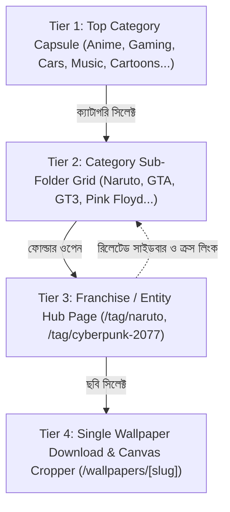

# 📂 WALPIX 4K — Category, Sub-Category & Franchise Folder Taxonomy Master Specification
**Document ID:** `SPEC-TAXONOMY-SUBFOLDERS-001`  
**Purpose:** AI Agent & Developer Hand-off Document for Category Capsules, Sub-Category Folders, and Entity Routing Architecture.  
**Inspired By:** WallpaperCat, Wallspic, and Xtrafondos 4-Tier Internal Linking Hierarchy.

---

## ১. ওভারভিউ ও মূল কনসেপ্ট (Architecture Overview)

পূর্বে আমাদের আলোচনা ও বাস্তবায়িত সিস্টেম অনুযায়ী, ওয়ালপেপার পেজটি শুধুমাত্র এলোমেলো ছবির গ্যালারি নয়, বরং এটি একটি **৪-টিয়ার হায়ারার্কিকাল ফোল্ডার ও সাইলো আর্কিটেকচার (4-Tier Silo & Folder Tree)**।

### ইউজার জার্নি ও লজিক ফ্লো:
1. **টপ ক্যাপসুল বার (Top Category Pills):** ব্যবহারকারী যখন পেজের শীর্ষে থাকা কোনো ক্যাটাগরি ক্যাপসুলে ক্লিক করে (যেমন: `Anime`, `Gaming`, `Cartoons`, `Cars`, `Music`), তখন পেজে এলোমেলো ছবি আসার বদলে ঐ ক্যাটাগরির **ভিজ্যুয়াল সাব-ফোল্ডার গ্রিড (Franchise Folders)** দৃশ্যমান হয়।
2. **সাব-ফোল্ডার গ্রিড (Franchise/Sub-Category Folders):** প্রতিটি ফোল্ডার একটি ১৬:৯ কার্ড হিসেবে থাকে। এতে ফোল্ডার কভার ইমেজ, ফোল্ডার আইকন, স্পেশাল ব্যাজ (যেমন: `Sage Mode 4K`, `Vice City 4K`) এবং মোট ওয়ালপেপার কাউন্ট (যেমন: `1,420+ Wallpapers`) থাকে।
3. **ফোল্ডারে ক্লিক করলে (Entity Page `/tag/[slug]` বা `/category/[slug]`):** ইউজার যখন নির্দিষ্ট ফোল্ডারে (যেমন: `Naruto`) ক্লিক করে, তখন সে সরাসরি ঐ ফ্র্যাঞ্চাইজির ডেডিকেটেড পেজে প্রবেশ করে। সেখানে কেবল নারুটো বা ঐ বিষয়ের ছবিগুলোই দেখা যায় এবং সাথে সাব-ক্যারেক্টার ফিল্টার ও রিলেটেড ফ্র্যাঞ্চাইজি লিংক থাকে।

---

## ২. টপ ক্যাপসুল লিস্ট (Top Navigation Pills)

ওয়ালপেপার পেজের ফিল্টার টুলবারে (`GalleryFilterToolbar.astro`) মোট **২৩টি মূল ক্যাপসুল** রয়েছে:

| # | ক্যাপসুল আইডি (ID) | ক্যাপসুল নাম (Display Name) | আইকন ভেক্টর | ফোল্ডার ডেটা কি (Key) |
|---|---|---|---|---|
| ১ | `all` | All Wallpapers | `grid` | সমস্ত ওয়ালপেপারের সমন্বিত গ্যালারি |
| ২ | `4k` | 4K Ultra HD | `monitor` | `4k` (3840×2160 রেজোলিউশন ফোল্ডার) |
| ৩ | `hd` | HD Wallpapers | `monitor` | `hd` (1080p / 2K ক্লিয়ার ফোল্ডার) |
| ৪ | `cartoon` | Cartoons | `anime` | `cartoon` (ডিজনি, পিক্সার, অ্যানিমেশন) |
| ৫ | `anime` | Anime & Manga | `anime` | `anime` (নারুটো, জুজুৎসু, ওয়ান পিস ইত্যাদি) |
| ৬ | `gaming` | Gaming | `gamepad` | `gaming` (জিটিএ, সাইবারপাঙ্ক, এল্ডেন রিং) |
| ৭ | `music` | Music & Bands | `music` | `music` (রক, হিপ-হপ, কে-পপ, ব্যান্ড) |
| ৮ | `amoled` | AMOLED Black | `amoled` | `amoled` (পিওর ব্ল্যাক #000000 ফোল্ডার) |
| ৯ | `cyberpunk` | Cyberpunk & Neon | `cyberpunk` | `cyberpunk` (নিওন, রেট্রোওয়েভ, সিন্থওয়েভ) |
| ১০ | `cars` | Cars & Bikes | `cars` | `cars` (পোর্শে, ল্যাম্বরগিনি, জেডিএম, বাইক) |
| ১১ | `nature` | Nature & Scenery | `nature` | `nature` (পাহাড়, বন, জলপ্রপাত, হ্রদ) |
| ১২ | `space` | Space & Cosmic | `space` | `space` (অ্যাস্ট্রোনট, নেবুলা, গ্যালাক্সি) |
| ১৩ | `superheroes` | Superheroes | `superheroes` | `superheroes` (মার্ভেল, ডিসি, ব্যাটম্যান) |
| ১৪ | `movies` | Movies | `movies` | `movies` (হলিউড, সাই-ফাই ক্লাসিকস) |
| ১৫ | `tv-shows` | TV Shows | `movies` | `tv-shows` (ব্রেকিং ব্যাড, স্ট্রেঞ্জার থিংস) |
| ১৬ | `minimalist` | Minimalist | `minimalist` | `minimalist` (ক্লিন ভেক্টর, মিনিমাল শেপ) |
| ১৭ | `abstract` | 3D & Abstract | `abstract` | `abstract` (লিকুইড ক্রোম, ৩ডি প্রিজম) |
| ১৮ | `dark` | Dark Mode | `dark` | `dark` (ডার্ক ভয়েড, গোথিক শ্যাডোস) |
| ১৯ | `fantasy` | Fantasy | `fantasy` | `fantasy` (ড্রাগন, ম্যাজিক সিটি, এলভস) |
| ২০ | `city` | City & Architecture | `city` | `city` (টোকিও নাইট, ম্যানহাটন স্কাইলাইন) |
| ২১ | `animals` | Animals & Wildlife | `animals` | `animals` (নেকড়ে, বাঘ, সিংহ, সমুদ্রপ্রাণী) |
| ২২ | `celebrities` | Celebrities | `celebrities` | `celebrities` (পপস্টার, অ্যাক্টর পোর্ট্রেট) |
| ২৩ | `sports` | Sports & Racing | `sports` | `sports` (ফুটবল, এনবিএ, ফর্মুলা ১) |

---

## ৩. প্রতিটি ক্যাটাগরির অন্তর্ভুক্ত সাব-ক্যাটাগরি / ফোল্ডারের পূর্ণ তালিকা (Exhaustive Directory)

### ১. Anime & Manga (`anime`) — ১৩,৫০০+ ওয়ালপেপার
* `naruto` — **Naruto & Shinobi** (ব্যাজ: `Sage Mode 4K`, ১৩৪০+ ছবি)
* `jujutsu-kaisen` — **Jujutsu Kaisen** (ব্যাজ: `Cursed Realm`, ৯৮০+ ছবি)
* `one-piece` — **One Piece** (ব্যাজ: `Gear 5 Joyboy`, ১৫৪০+ ছবি)
* `demon-slayer` — **Demon Slayer (Kimetsu)** (ব্যাজ: `Breathing Styles`, ১১২০+ ছবি)
* `dragon-ball` — **Dragon Ball Z / Super** (ব্যাজ: `Ultra Instinct`, ১২৫০+ ছবি)
* `attack-on-titan` — **Attack on Titan** (ব্যাজ: `Shingeki 4K`, ৮৯০+ ছবি)
* `studio-ghibli` — **Studio Ghibli Scenic** (ব্যাজ: `Miyazaki Masterpiece`, ৮৫০+ ছবি)
* `bleach` — **Bleach & Bankai** (ব্যাজ: `Thousand-Year War`, ৭৪০+ ছবি)
* `chainsaw-man` — **Chainsaw Man** (ব্যাজ: `Devil Hunter`, ৬৮০+ ছবি)
* `solo-leveling` — **Solo Leveling** (ব্যাজ: `Shadow Monarch`, ৫৯০+ ছবি)
* `samurai` — **Anime Blade Samurai** (ব্যাজ: `Katana Mist`, ৮২০+ ছবি)
* `tokyo-ghoul` — **Tokyo Ghoul & Ken Kaneki** (ব্যাজ: `Ghoul Mask`, ৪৫০+ ছবি)
* `hunter-x-hunter` — **Hunter x Hunter** (ব্যাজ: `Nen Aura`, ৫২০+ ছবি)

### ২. Cartoons & Animation (`cartoon`) — ৯,৫০০+ ওয়ালপেপার
* `rick-and-morty` — **Rick and Morty** (ব্যাজ: `Multiverse 4K`, ৭২০+ ছবি)
* `spider-verse` — **Spider-Man: Spider-Verse** (ব্যাজ: `Miles Morales`, ৮৫০+ ছবি)
* `disney-pixar` — **Disney & Pixar Classics** (ব্যাজ: `Magic Kingdom`, ১১০০+ ছবি)
* `spongebob` — **SpongeBob SquarePants** (ব্যাজ: `Bikini Bottom Aesthetic`, ৪২০+ ছবি)
* `avatar-airbender` — **Avatar: The Last Airbender** (ব্যাজ: `Four Elements`, ৪৮০+ ছবি)
* `arcane` — **Arcane: League of Legends** (ব্যাজ: `Zaun & Piltover`, ৯২০+ ছবি)
* `batman-animated` — **Batman: The Animated Series** (ব্যাজ: `Gotham Noir`, ৫১০+ ছবি)
* `gravity-falls` — **Gravity Falls** (ব্যাজ: `Mystery Shack`, ৩৪০+ ছবি)

### ৩. Gaming & Esports (`gaming`) — ১৮,২০০+ ওয়ালপেপার
* `cyberpunk-2077` — **Cyberpunk 2077** (ব্যাজ: `Night City Overdrive`, ১৬৫০+ ছবি)
* `grand-theft-auto-5` — **Grand Theft Auto (GTA V/6)** (ব্যাজ: `Vice City 4K`, ২২৪০+ ছবি)
* `elden-ring` — **Elden Ring & Soulsborne** (ব্যাজ: `Lands Between`, ১১২০+ ছবি)
* `god-of-war` — **God of War (Ragnarok)** (ব্যাজ: `Norse Realms`, ১৩১০+ ছবি)
* `red-dead-redemption` — **Red Dead Redemption 2** (ব্যাজ: `Outlaws 4K`, ১৫৪০+ ছবি)
* `valorant` — **Valorant & Riot Agents** (ব্যাজ: `Radiant Agents`, ১৪২০+ ছবি)
* `the-witcher` — **The Witcher 3: Wild Hunt** (ব্যাজ: `White Wolf`, ৮৯০+ ছবি)
* `genshin-impact` — **Genshin Impact & Honkai** (ব্যাজ: `Teyvat Scenic`, ১৭২০+ ছবি)
* `minecraft` — **Minecraft RTX Shaders** (ব্যাজ: `Ultra Shaders`, ১১০০+ ছবি)
* `need-for-speed` — **Need for Speed & Street Racing** (ব্যাজ: `Heat & Unbound`, ৯৮০+ ছবি)
* `ghost-of-tsushima` — **Ghost of Tsushima** (ব্যাজ: `Samurai Honor`, ৬৫০+ ছবি)
* `assassins-creed` — **Assassin's Creed** (ব্যাজ: `Animus Sync`, ৮৫০+ ছবি)

### ৪. Music & Bands (`music`) — ৭,৬০০+ ওয়ালপেপার
* `rock-legends` — **Classic Rock Legends** (ব্যাজ: `Pink Floyd & Queen`, ৮২০+ ছবি)
* `heavy-metal` — **Heavy Metal & Slipknot** (ব্যাজ: `Metallica & Rock`, ৬৫০+ ছবি)
* `hip-hop` — **Hip-Hop & Rap Kings** (ব্যাজ: `Eminem & Travis Scott`, ৯৪০+ ছবি)
* `pop-superstars` — **Pop Superstars** (ব্যাজ: `The Weeknd & Taylor`, ১২০০+ ছবি)
* `kpop-idols` — **K-Pop Idols** (ব্যাজ: `BTS & BLACKPINK`, ১৪৫০+ ছবি)
* `electronic-synthwave` — **Electronic & Daft Punk** (ব্যাজ: `EDM & Synth`, ৭২০+ ছবি)
* `music-instruments` — **Studio, Guitars & Vinyl** (ব্যাজ: `Acoustic & Neon`, ৮১০+ ছবি)

### ৫. AMOLED Black & OLED (`amoled` / `dark`) — ১২,০০০+ ওয়ালপেপার
* `amoled-black` — **True OLED Black Void** (ব্যাজ: `#000000 0% Lit`, ৩২০০+ ছবি)
* `fluid` — **Minimal Dark Waves** (ব্যাজ: `Fluid Waveform`, ১৪৫০+ ছবি)
* `neon` — **AMOLED Neon Lines** (ব্যাজ: `HDR Glow`, ১৮২০+ ছবি)
* `particles` — **Golden Particle Wave** (ব্যাজ: `Luxury Particle`, ৯৮০+ ছবি)
* `dark-aesthetic` — **Obsidian Geometric Sphere** (ব্যাজ: `Minimal 3D`, ৮৯০+ ছবি)
* `gt3-stealth` — **Matte Black GT3 Supercar** (ব্যাজ: `Stealth Automotive`, ১২৪০+ ছবি)

### ৬. Cars & Supercars (`cars`) — ১৪,৮০০+ ওয়ালপেপার
* `porsche-911` — **Porsche 911 GT3 RS** (ব্যাজ: `Track Weapon`, ১৮৫০+ ছবি)
* `lamborghini` — **Lamborghini Aventador & Revuelto** (ব্যাজ: `V12 Hypercar`, ২১২০+ ছবি)
* `nissan-gtr` — **Nissan Skyline GT-R (R34/R35)** (ব্যাজ: `JDM Legend`, ১৬৪০+ ছবি)
* `ferrari` — **Ferrari Daytona & SF90** (ব্যাজ: `Maranello Exotic`, ১৪২০+ ছবি)
* `bmw-m` — **BMW M Power & Competition** (ব্যাজ: `Motorsport Performance`, ১৩৮০+ ছবি)
* `mclaren` — **McLaren P1 & 720S** (ব্যাজ: `Aero Hypercar`, ৯৫০+ ছবি)
* `mercedes-amg` — **Mercedes-AMG GT Black Series** (ব্যাজ: `Affalterbach Beast`, ১১২০+ ছবি)
* `superbikes` — **Superbikes & Ducati Panigale** (ব্যাজ: `Superbike Racing`, ৮৯০+ ছবি)

### ৭. Space & Cosmic (`space`) — ৯,৮০০+ ওয়ালপেপার
* `astronaut` — **Cosmic Astronaut Horizon** (ব্যাজ: `Deep Space 4K`, ১৪২০+ ছবি)
* `nebula` — **Interstellar Nebulae** (ব্যাজ: `Pillars of Creation`, ১৬৮০+ ছবি)
* `planets` — **Solar System & Exoplanets** (ব্যাজ: `Saturn & Mars`, ১৩৫০+ ছবি)
* `galaxy` — **Andromeda Galaxy Collision** (ব্যাজ: `Milky Way Core`, ১১২০+ ছবি)
* `black-hole` — **Gargantua Black Hole** (ব্যাজ: `Event Horizon`, ৯৫০+ ছবি)
* `james-webb` — **James Webb Deep Field** (ব্যাজ: `NASA JWST`, ৮৯০+ ছবি)

### ৮. Superheroes & Comics (`superheroes`) — ১০,২০০+ ওয়ালপেপার
* `batman` — **Batman: Dark Knight & Gotham** (ব্যাজ: `Batmobile 4K`, ১৮৫০+ ছবি)
* `spider-man` — **Spider-Man (Peter & Miles)** (ব্যাজ: `Web Slinger`, ১৯২০+ ছবি)
* `iron-man` — **Iron Man & Avengers** (ব্যাজ: `Stark Industries`, ১৪৫০+ ছবি)
* `superman` — **Superman: Man of Steel** (ব্যাজ: `Krypton Legend`, ৯২০+ ছবি)
* `joker` — **Joker & Gotham Villains** (ব্যাজ: `Arkham Chaos`, ৮৯০+ ছবি)
* `deadpool-wolverine` — **Deadpool & Wolverine** (ব্যাজ: `Merc With a Mouth`, ১২৮০+ ছবি)

### ৯. Movies & TV Shows (`movies`, `tv-shows`) — ৮,৯০০+ ওয়ালপেপার
* `interstellar` — **Interstellar & Sci-Fi Cinema** (ব্যাজ: `Nolan Masterpiece`, ১১৫০+ ছবি)
* `peaky-blinders` — **Peaky Blinders (Thomas Shelby)** (ব্যাজ: `Birmingham 1919`, ৯৮০+ ছবি)
* `breaking-bad` — **Breaking Bad & Walter White** (ব্যাজ: `Heisenberg 4K`, ৮৫০+ ছবি)
* `stranger-things` — **Stranger Things** (ব্যাজ: `The Upside Down`, ৯২০+ ছবি)
* `game-of-thrones` — **Game of Thrones & House of Dragon** (ব্যাজ: `Iron Throne`, ১১২০+ ছবি)
* `star-wars` — **Star Wars & The Mandalorian** (ব্যাজ: `Jedi & Sith`, ১৩৫০+ ছবি)
* `lord-of-the-rings` — **Lord of the Rings** (ব্যাজ: `Middle Earth`, ৮৯০+ ছবি)
* `dune` — **Dune & Arrakis Sandworms** (ব্যাজ: `Spice Planet`, ৭৪০+ ছবি)

### ১০. Nature & Scenery (`nature`) — ১৬,৫০০+ ওয়ালপেপার
* `mountains` — **Alpine Mountains & Snowy Peaks** (ব্যাজ: `Matterhorn & Alps`, ২৪৫০+ ছবি)
* `forests` — **Evergreen Misty Forests & Pines** (ব্যাজ: `Pacific Northwest`, ১৯২০+ ছবি)
* `waterfalls` — **Glacial Lakes & Waterfalls** (ব্যাজ: `Crystal Waters`, ১৬৪০+ ছবি)
* `ocean-beach` — **Ocean Waves & Tropical Beaches** (ব্যাজ: `Pacific Waves`, ১৪৮০+ ছবি)
* `aurora` — **Northern Lights (Aurora Borealis)** (ব্যাজ: `Norway Night Sky`, ১৩২০+ ছবি)
* `desert-canyon` — **Desert Dunes & Red Rock Canyons** (ব্যাজ: `Sahara & Sedona`, ৮৯০+ ছবি)

### ১১. Minimalist & 3D Abstract (`minimalist`, `abstract`) — ১৭,৬০০+ ওয়ালপেপার
* `liquid-chrome` — **Liquid Chrome & Molten Metal** (ব্যাজ: `3D Reflective`, ১২৫০+ ছবি)
* `geometry` — **Geometric Prisms & Spheres** (ব্যাজ: `Minimal Math`, ১৩৮০+ ছবি)
* `waveforms` — **Smooth Fluid Gradient Waves** (ব্যাজ: `Pastel Silk`, ১৬২০+ ছবি)
* `apple-minimal` — **Apple Desktop Clean Aesthetics** (ব্যাজ: `Cupertino Minimal`, ১৮৫০+ ছবি)
* `glassmorphism` — **Glassmorphism Frosted Acrylic** (ব্যাজ: `Blur Prism`, ৯৮০+ ছবি)

### ১২. City & Architecture (`city`) — ৯,১০০+ ওয়ালপেপার
* `tokyo-neon` — **Neo Tokyo Rain Alley** (ব্যাজ: `Shinjuku Cyber`, ১৮২০+ ছবি)
* `manhattan` — **Manhattan Midnight Skyline** (ব্যাজ: `NYC 8K`, ১৬৫০+ ছবি)
* `megacity` — **Futuristic Dystopian Megacity** (ব্যাজ: `Sci-Fi Metropolis`, ১৪২০+ ছবি)
* `cyber-architecture` — **Modern Minimalist Villas & Lofts** (ব্যাজ: `Architectural Digest`, ৮৯০+ ছবি)

### ১৩. Animals & Wildlife (`animals`) — ৬,৪০০+ ওয়ালপেপার
* `wolves` — **Arctic Snow Wolf & Lone Alpha** (ব্যাজ: `Predator Eyes`, ১২২০+ ছবি)
* `big-cats` — **Sovereign Lions, Tigers & Panthers** (ব্যাজ: `Apex King`, ১৫৪০+ ছবি)
* `cyber-wildlife` — **Neon Cybernetic Beasts** (ব্যাজ: `Synthwave Safari`, ৯৮০+ ছবি)
* `marine-life` — **Ocean Whales, Orcas & Deep Sea** (ব্যাজ: `Abyssal 4K`, ৭৫০+ ছবি)
* `birds-prey` — **Golden Eagles & Falcons** (ব্যাজ: `Soaring Sky`, ৬২০+ ছবি)

---

## ৪. প্রযুক্তিগত লজিক ও কম্পোনেন্ট ডিরেক্টরি (Implementation Logic & Components)

আমাদের কোডবেসে এই সিস্টেমটি পরিচালনা করার জন্য নিম্নলিখিত কম্পোনেন্ট এবং ডেটা ফাইলগুলো সংযুক্ত রয়েছে:

1. **`src/components/GalleryFilterToolbar.astro`:**
   * টপ ক্যাপসুল রেন্ডার করে।
   * ব্যবহারকারী যখন কোনো ক্যাপসুল ক্লিক করে, তখন এটি `walpix-category-change` কাস্টম ইভেন্ট ফায়ার করে।
   * `All Wallpapers` বাদে অন্য যেকোনো ক্যাপসুল সিলেক্ট করলে এটি ওয়ালপেপার গ্রিডের পাশাপাশি বা তার উপরে ক্যাটাগরি ফোল্ডার ভিউ টগল করে।

2. **`src/components/CategoryFolderView.astro`:**
   * ৩-কলামের প্রিমিয়াম ১৬:৯ কার্ড গ্রিড রেন্ডার করে।
   * প্রতিটি ফোল্ডারের জন্য `getFolderThumb()` ফাংশন দিয়ে অপ্টিমাইজড থাম্বনেইল প্রদর্শন করে।
   * প্রতিটি ফোল্ডার কার্ডের লিংক: `/tag/[slug]` (যেমন: `/tag/naruto`)।
   * ইন-ফিড অ্যাডসেন্স স্লট ধারণ করে (কার্ড ইন্ডেক্স ৫, ১৭, ২৯ এ)।

3. **`src/components/CategorySubFolderStrip.astro`:**
   * ক্যাটাগরিভিত্তিক সাব-ফোল্ডারের মূল ডেটাবেজ (`CATEGORY_SUBFOLDERS` রেকর্ড)।
   * প্রতিটি ফোল্ডারের নাম, স্লাগ, ওয়ালপেপার কাউন্ট, ব্যাজ এবং থাম্বনেইল পাথ সংরক্ষণ করে।

4. **`src/components/SubFolderGrid.astro`:**
   * ডেডিকেটেড ক্যাটাগরি পেজে (`/category/[category].astro`) ক্যাটাগরির নিজস্ব সাব-টপিক ও ফ্র্যাঞ্চাইজি ফোল্ডারগুলো দেখায়।

5. **`src/pages/tag/[slug].astro`:**
   * যেকোনো ফোল্ডারে ক্লিক করার পর এই পেজে ল্যান্ড করে।
   * উদাহরণ: `/tag/naruto` তে গেলে নারুটোর H1 হেডলাইন, ক্যারেক্টার ফিল্টার চিপস (`Naruto`, `Kakashi`, `Itachi`, `Kurama`), ডাউনলোড অপশন ও ওয়ালপেপার গ্রিড লোড হয়।

---

## ৫. এআই এজেন্টের জন্য পরবর্তী করণীয় নির্দেশিকা (Action Guidelines for Future Agents)

1. **ক্যাপসুল বাটন ও ফোল্ডার সমন্বয়:**
   * ফিল্টার টুলবারের ক্যাপসুল এবং সাব-ফোল্ডার ডেটার কী (`anime`, `gaming`, `cars` ইত্যাদি) যেন হুবহু মিল থাকে।
2. **জিরো লেআউট শিফট (Zero CLS):**
   * ক্যাপসুল সক্রিয় হলে কোনো জাম্প বা কাঁপুনি হবে না; `content-visibility: auto` এবং ফিক্সড রেশিও `aspect-[16/9]` বজায় রাখতে হবে।
3. **ইউআই লক কমপ্লায়েন্স:**
   * বিদ্যমান ফন্ট (`Outfit`, `Inter`), বর্ডার স্টাইল, গ্লাস-মরফিজম এবং অ্যাকসেন্ট কালার (`#C2FF06`) কোনোভাবেই পরিবর্তন বা নষ্ট করা যাবে না।
