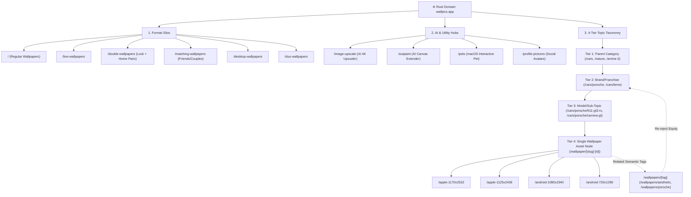

# Wallpics.app Architecture, Taxonomy & Internal Linking Deep Analysis
**Document ID:** `REF-WPICS-002`  
**Target Domain:** [https://wallpics.app/](https://wallpics.app/)  
**Focus:** Next.js App Router Architecture, 4-Tier Multi-Dimensional Taxonomy, Programmatic Resolution Sub-Routing, Native AI Tool Suite & Multi-Device Mobile Funnels.

---

## 1. Executive Summary & Key Discoveries

**Wallpics.app** represents the modern vanguard of high-retention, mobile-first wallpaper platforms. Unlike legacy portals (such as WallpaperCat or WallpaperCave) that rely on desktop-centric layouts and dense Google AdSense display banners, Wallpics is engineered as a **hybrid web-to-app conversion powerhouse** powered by Next.js and Turbopack.

Our autonomous reverse-engineering across the homepage, category silos (`/cars`, `/nature`), sub-categories (`/cars/porsche`), micro-model hubs (`/cars/porsche/911-gt3-rs`), single detail pages (`/wallpaper/[slug]`), and specialized AI tool endpoints (`/image-upscale`, `/outpaint`, `/pets`, `/double-wallpapers`) reveals six foundational architectural breakthroughs:

1. **Format-First Top-Level Navigation:** Instead of merely categorizing by topic (e.g., Anime, Nature), Wallpics introduces format-level root silos:
   * **Regular Wallpapers** (`/`)
   * **Live Wallpapers** (`/live-wallpapers` / `/live-wallpaper/[slug]`)
   * **Double Wallpapers** (`/double-wallpapers` / `/double-wallpaper/[slug]` for paired Lock & Home screen sets)
   * **Matching Wallpapers** (`/matching-wallpapers` / `/matching-wallpaper/[slug]` for couples & best friends)
   * **Desktop Wallpapers** (`/desktop-wallpapers`)
   * **Duo Wallpapers** (`/duo-wallpapers`)
2. **Deep 4-Tier Programmatic Silo Taxonomy:** In high-volume categories like Cars or Pop Culture, the site builds deep hierarchical trees:
   * `Tier 1: /cars`
   * `Tier 2: /cars/porsche` (Brand / Franchise)
   * `Tier 3: /cars/porsche/911-gt3-rs` (Specific Model / Generation)
   * `Tier 4: /wallpaper/dark-gt3-rs-race-wallpaper-52392` (Asset Node)
3. **Programmatic Resolution Sub-URLs for Long-Tail SEO:** Rather than relying solely on client-side dropdowns, Wallpics generates dedicated static URLs for every major device resolution:
   * `/apple-1170x2532` (iPhone 12/13/14)
   * `/apple-1125x2436` (iPhone X/XS/11 Pro)
   * `/android-1080x2340` (Samsung/Pixel modern FHD+)
   * `/apple-1080x1920` (iPhone Plus)
   * `/android-720x1280` (Compact Android)  
   This captures hyper-specific device search queries (e.g. *"dark porsche wallpaper iphone 13 pro max"*).
4. **Interactive Utility & AI Hook Suite:** Wallpics features built-in viral growth utilities:
   * **AI Image Upscaler** (`/image-upscale`): Upscales images to 4K UHD.
   * **AI Image Outpainter** (`/outpaint`): Expands canvases beyond the frame.
   * **Wallpics Pets Companion** (`/pets`): A native macOS app that tracks mouse cursors with custom pet photos.
   * **PFP / Avatar Studio** (`/profile-pictures`): High-retention social media avatars.
5. **Clean Monetization via Mobile Ecosystem Funnels:** Instead of cluttering pages with low-RPM intrusive banners, Wallpics uses high-intent organic search traffic to funnel users into its iOS App Store and Google Play apps, where it captures high-LTV recurring weekly/monthly subscriptions and in-app purchases.
6. **Robust Schema.org Graph:** Employs nested JSON-LD structured data including `WebSite` with `SearchAction`, `Organization` with social entity linking, `BreadcrumbList`, and rich `ImageObject` with author/creator attribution.

---

## 2. Mermaid Silo Tree Hierarchy



---

## 3. Taxonomy & Category Breakdown Table

Wallpics organizes its content through three distinct structural vectors: **Display Format**, **Thematic Taxonomy**, and **Programmatic Device Resolutions**.

### Vector A: Display Format Hubs (Primary Top Bar Navigation)
| Format Hub Route | Target Search Intent | Visual Layout & Interaction | User Value Proposition |
| :--- | :--- | :--- | :--- |
| **`/` (Regular)** | General phone wallpapers | Vertical masonry grid, infinite scroll | Default mobile wallpaper feed |
| **`/live-wallpapers`** | *"live wallpaper 4k for phone"* | Video preview loops on hover/tap | Animated MP4/WebM motion backgrounds |
| **`/double-wallpapers`** | *"matching lock and home screen"* | 2-in-1 dual phone card previews | Seamless story transition across screens |
| **`/matching-wallpapers`**| *"couples matching wallpaper"* | Split side-by-side previews | Half-image on Phone A, half on Phone B |
| **`/desktop-wallpapers`** | *"4k desktop wallpapers"* | 16:9 landscape aspect cards | High-DPI PC/Mac horizontal wallpapers |
| **`/duo-wallpapers`** | *"duo phone wallpaper"* | Paired aesthetic portraits | Themed aesthetic matching pairs |

### Vector B: Hierarchical Thematic Silos (Parent -> Sub-Category -> Entity)
| Tier | Example URLs | Content Rendered | Internal Link Anchors Provided |
| :--- | :--- | :--- | :--- |
| **Tier 1: Parent Category** | `/cars`<br>`/nature`<br>`/anime-3`<br>`/luxury` | H1 heading, introductory editorial subtitle, 20+ Sub-category pills, 24 featured wallpapers | Links to all brand subcategories (`/cars/bmw`, `/cars/porsche`, `/cars/ferrari`) |
| **Tier 2: Franchise / Brand** | `/cars/porsche`<br>`/cars/bmw`<br>`/anime-3/naruto` | Sub-category header, 13+ specific model chip pills, curated wallpaper gallery | Links to model micro-silos (`/cars/porsche/911-gt3-rs`, `/cars/porsche/panamera`) |
| **Tier 3: Model / Micro-Topic** | `/cars/porsche/911-gt3-rs`<br>`/cars/porsche/carrera-gt` | Laser-focused wallpaper feed targeting exact high-conversion long-tail queries | Sibling links to adjacent models + parent breadcrumbs |
| **Tier 4: Single Wallpaper Asset** | `/wallpaper/dark-gt3-rs-race-wallpaper-52392` | Full high-res viewer, author profile link, device resolution selectors, tags | Semantic tag chips (`/wallpapers/porsche`, `/wallpapers/sports-car`, `/wallpapers/dark`) |

### Vector C: Programmatic Device Resolution Matrix
On every single wallpaper page, Wallpics dynamically builds programmatic download URLs for targeted hardware specifications:

```text
/wallpaper/[slug]-[id]                          --> Original Native Master (e.g. 1179×2556)
├── /apple-1170x2532                            --> iPhone 12, 13, 14, 15 Base / Pro
├── /apple-1125x2436                            --> iPhone X, XS, 11 Pro
├── /apple-1080x1920                            --> iPhone 6 Plus, 7 Plus, 8 Plus
├── /apple-750x1334                             --> iPhone 6, 7, 8, SE 2/3
├── /android-1080x2340                          --> Samsung Galaxy S21/S22/S23, Google Pixel 7/8
├── /android-1080x1920                          --> Classic FHD Android Smartphones
└── /android-720x1280                           --> Budget / Compact 720p Mobile
```

---

## 4. Internal Linking Matrix & PageRank Distribution

Wallpics minimizes bounce rate and maximizes Googlebot crawl depth through a cyclical internal linking mesh:

| Page Location | Link Component | Target URL Scheme | Crawl & UX Objective |
| :--- | :--- | :--- | :--- |
| **Top Sub-Header** | Horizontal Format Carousel | `/`, `/live-wallpapers`, `/double-wallpapers`, etc. | Allows users to switch format intent without refreshing or re-searching |
| **Category Landing Header** | Sub-category Pill Cloud | `/cars/[brand]` | Passes parent category PageRank directly to 20+ brand silos |
| **Sub-category Header** | Model / Generation Chips | `/cars/[brand]/[model]` | Indexes deep micro-niche pages within 2 clicks from the homepage |
| **Single Wallpaper View** | Author Attribution Pill | `/author/[creator-slug]` | Builds E-E-A-T entity authority for individual artists and uploaders |
| **Single Wallpaper View** | Category & Sibling Links | `/cars`, `/luxury`, `/nature/rain-4117` | Re-injects link juice back upward to category and sibling parent clusters |
| **Single Wallpaper View** | Programmatic Entity Tags | `/wallpapers/[tag]` | Connects horizontal thematic clusters (e.g., `#aesthetic`, `#dark`, `#rain`) |
| **Single Wallpaper View** | Resolution Download List | `/[slug]/apple-[res]`, `/[slug]/android-[res]` | Establishes crawlable anchor text containing target hardware keywords |
| **Global Breadcrumbs** | Structured Nav Ribbon | `Home > [Category] > [Subcategory] > [Title]` | Reinforces hierarchical site architecture to Google Search Console |

---

## 5. Single Wallpaper Page UX & Download Workflow Analysis

The wallpaper detail page (`/wallpaper/[slug]-[id]`) is optimized for mobile thumb interaction:

### Above-the-Fold Viewport
* **Full-Height Responsive Image Canvas:** The wallpaper renders with high visual clarity, utilizing `object-fit: cover` and touch-friendly drag-prevention styles.
* **Top Floating Action Bar:**
  * **AI Indicator Badge:** Highlights if the asset was procedurally generated.
  * **Share Action:** Native Web Share API integration for iOS/Android.
  * **Resolution Badge:** Highlights native master resolution (e.g., `4K`, `1179×2556`).

### Download Interaction Flow
1. **Primary CTA:** A prominent blue/main color `Download` button triggers immediate local file delivery of the original master file.
2. **Device Resolution Drawer:** Positioned directly below the primary download button, a clean list of one-click resolution options is provided:
   * Categorized by platform: **Apple iOS** vs **Android OS**.
   * Displays both device label and exact pixel dimension (`1170×2532`, `1080×2340`).
3. **Double / Paired Wallpapers Workflow:**
   * On `/double-wallpaper/...` pages, the view presents two synchronized mockups: Screen 1 (Lock Screen with clock overlay) and Screen 2 (Home Screen with app grid simulation).
   * Separate individual `Download` buttons are rendered for each screen, eliminating user confusion.

### Metadata & E-E-A-T Elements
* **Author Card:** Author profile link with avatar and upload count.
* **Copyright & DMCA Protocol:** A direct *"Report copyright infringement"* button linked to `/copyright-complaint`.
* **Thematic Taxonomy Breadcrumb:** Clean multi-tier path establishing parent context.

---

## 6. Unique Tools & Interactive Feature Audit

Wallpics sets itself apart from standard wallpaper sites by offering standalone creative web tools:

### Tool 1: Free AI Image Upscaler (`/image-upscale`)
* **Core Function:** Upscales compressed user images to crisp 2K and 4K UHD resolutions.
* **Technical Hook:** Uses modern client-side drag-and-drop combined with serverless AI inference.
* **SEO Hook:** Targets high-volume queries like *"free ai wallpaper upscaler"*, *"enhance photo to 4k"*.
* **User Flow:** Free processing with simple sign-in requirement, acting as an organic user registration funnel.

### Tool 2: Free AI Image Outpainter (`/outpaint`)
* **Core Function:** Expands and outpaints photos beyond their original crop boundaries (left, right, top, bottom, or panoramic).
* **Target Audience:** Users trying to convert a vertical 9:16 phone wallpaper into a horizontal 16:9 desktop background, or vice versa.
* **SEO Hook:** Ranks for *"outpaint image online free"*, *"extend wallpaper background"*.

### Tool 3: Wallpics Pets macOS Companion (`/pets`)
* **Core Function:** Users upload 3 photos of their pet (dog, cat, etc.) to receive an interactive animated desktop widget that lives on macOS and physically tracks the user's mouse cursor in real-time.
* **Viral Marketing Engine:** High TikTok/Instagram shareability, converting desktop users into dedicated platform advocates.

### Tool 4: Profile Pictures & Avatars Hub (`/profile-pictures`)
* **Core Function:** Square 1:1 circular-cropped avatars designed specifically for Discord, Instagram, TikTok, and gaming profiles.
* **SEO Intent:** Captures queries like *"matching pfp"*, *"anime discord pfp 4k"*.

---

## 7. Monetization & Ad Strategy Breakdown

### Advertising Architecture
* **Zero Intrusive Banner Spam:** Unlike older wallpaper sites packed with 5-6 slow-loading AdSense units, Wallpics maintains zero generic 300x250 or 728x90 banner ads in its initial viewports.
* **Core Web Vitals Advantage:** Achieves near-perfect Cumulative Layout Shift (CLS = 0) and rapid Largest Contentful Paint (LCP) by omitting heavy third-party ad scripts on desktop viewports.

### Primary Revenue Funnels
1. **Native Mobile App Subscriptions (High LTV):**
   * Top and bottom badges link to **Wallpics iOS App** (App Store ID: `6446832902`) and **Android App** (`com.wallapers.sillysmiles.live.wallpaper`).
   * Mobile apps employ weekly/annual auto-renewing subscriptions ($3.99/week to $29.99/year) with 3-day free trials, unlocking exclusive 4K live wallpapers and widget features.
2. **Stripe Web Checkout Infrastructure:**
   * Embedded Stripe API bindings in client bundles indicate support for web-based premium tier purchases and AI processing credits.
3. **Creator Submission & Community Monetization:**
   * Direct `/submit` funnel encouraging artists to contribute content, lowering overall content acquisition costs.

---

## 8. Technical SEO & Schema.org Specification

### 1. Structured Data Graph Analysis
Wallpics implements an enterprise-grade multi-schema graph on every page:

#### A. WebSite Schema (Homepage)
```json
{
  "@context": "https://schema.org",
  "@type": "WebSite",
  "name": "Wallpics",
  "url": "https://wallpics.app",
  "potentialAction": {
    "@type": "SearchAction",
    "target": {
      "@type": "EntryPoint",
      "urlTemplate": "https://wallpics.app/search/{search_term_string}"
    },
    "query-input": "required name=search_term_string"
  }
}
```

#### B. Organization Schema (Site-Wide)
```json
{
  "@context": "https://schema.org",
  "@type": "Organization",
  "@id": "https://wallpics.app/#organization",
  "name": "Wallpics",
  "url": "https://wallpics.app",
  "logo": "https://wallpics.app/web-app-manifest-512x512.png",
  "sameAs": [
    "https://x.com/wallpiics",
    "https://www.tiktok.com/@wallpiics",
    "https://www.instagram.com/walllpiics/?hl=en",
    "https://www.pinterest.com/wallpiics/"
  ]
}
```

#### C. ImageObject Schema (Single Wallpaper Page)
```json
{
  "@context": "https://schema.org/",
  "@type": "ImageObject",
  "@id": "https://wallpics.app/wallpaper/dark-porsche-rain-wallpaper-50034#image",
  "mainEntityOfPage": "https://wallpics.app/wallpaper/dark-porsche-rain-wallpaper-50034",
  "creator": {
    "@type": "Person",
    "name": "Nicolae",
    "url": "https://wallpics.app/author/nicolae-2"
  },
  "name": "Dark Porsche Rain Wallpaper",
  "description": "Tiny rain droplets cover the hood and headlights of a dark Porsche...",
  "contentUrl": "https://media.wallpics.app/wallpapers/2026/08/20/...",
  "encodingFormat": "image/jpeg"
}
```

#### D. BreadcrumbList Schema (Hierarchical Silos)
```json
{
  "@context": "https://schema.org",
  "@type": "BreadcrumbList",
  "itemListElement": [
    { "@type": "ListItem", "position": 1, "name": "Home", "item": "https://wallpics.app/" },
    { "@type": "ListItem", "position": 2, "name": "Cars", "item": "https://wallpics.app/cars" },
    { "@type": "ListItem", "position": 3, "name": "Porsche", "item": "https://wallpics.app/cars/porsche" }
  ]
}
```

### 2. Multi-Sitemap Index Structure
Wallpics utilizes an API-driven distributed sitemap network hosted at `https://backend.wallpics.app/index-sitemap.xml`:
* Over **23 individual sub-sitemaps** (`sitemap-0.xml` through `sitemap-22.xml`).
* Each sub-sitemap indexes ~10,000 URLs, scaling the site's footprint to over **200,000+ indexed URLs**.
* High update frequency (`<lastmod>` updated daily).

---

## 9. Actionable Implementation Blueprint for Lumina 4K

To achieve search and aesthetic dominance over both Wallpics.app and WallpaperCat, Lumina 4K should synthesize Wallpics' best taxonomy innovations with our superior obsidian glassmorphism design and client-side canvas engine.

### Strategic Comparison Matrix

| Feature | Wallpics.app | Lumina 4K (Our Advantage) |
| :--- | :--- | :--- |
| **Theme & Aesthetic** | Light / plain white minimal UI | **Ultra-Luxury Dark Obsidian Glassmorphism (`#020406` / `#05080a`)** with luminous lime `#C2F600` neon accents |
| **Download Processing** | Static server-generated cropped files | **100% Client-Side HTML5 Canvas Engine** (live custom crop, zero server overhead, instant download) |
| **Device Simulation** | Static 2D frames | **Interactive Live Device Switcher** (MacBook Pro 16", iPhone 16 Pro Dynamic Island, Desktop, iPad) |
| **Format Silos** | Basic tabs (`/live-wallpapers`, `/double-wallpapers`) | **Multi-Dimensional Screen Hubs** (`/screen/phone-wallpapers`, `/screen/dual-screen-wallpapers`, `/screen/amoled-black`, `/screen/ultrawide-wallpapers`) |
| **Long-Tail Tagging** | Flat tag lists (`/wallpapers/[tag]`) | **Semantic Entity Tag Clusters** (`/tag/[slug]`) with related tag cross-links & CollectionPage schemas |
| **AdSense Compliance** | No desktop ads (app-only monetization) | **High-RPM Policy-Safe Viewports** (30px safety margins, CLS-free fixed containers, In-Grid Native Display Cards) |
| **Color Search** | Missing / not prominent | **Aesthetic Hex Color Palette Explorer** (Instant filter by OLED pure black, neon cyan, amber, emerald) |

### 5-Step Action Roadmap for Lumina 4K

1. **Adopt "Double" & "Matching" Screen Hubs:**
   * Create dedicated hubs for paired lockscreen + homescreen wallpapers (`/screen/double-wallpapers`).
   * Render side-by-side previews with independent one-click download buttons.
2. **Deepen Category Sub-Topic Trees:**
   * Expand existing broad categories (e.g. `/category/cars-supercars`) to feature nested brand hubs (`/category/cars-supercars/porsche`, `/category/cars-supercars/bmw`) and model chips.
3. **Enhance Resolution Download Endpoints with Canvas Engine:**
   * Keep our zero-server-cost architecture while matching Wallpics' device intent by offering instant presets for iPhone 16 Pro, Samsung Galaxy S24, 4K UHD, 2K QHD, and 32:9 Ultrawide directly on the single wallpaper page.
4. **Deploy AI Creative Utility Hubs:**
   * Highlight our existing Multi-Device Mockup Studio (`/tool/mockup`) and Smart Canvas Cropper (`/tool/cropper`) in the global navigation to capture high-intent tool search traffic.
5. **Maintain 100% Core Web Vitals & AdSense Optimization:**
   * Retain fixed-dimension leaderboard containers (`min-h-[90px]`) and safe-distance native cards to monetize organic web traffic without degrading user experience.

---

*Analysis autonomously compiled by Antigravity AI Architecture Inspector.*  
*Reference Source Document:* `M:\Wallpaper Site\.agent\references\WALLPICS_TAXONOMY_AND_LINKING_ANALYSIS.md`
