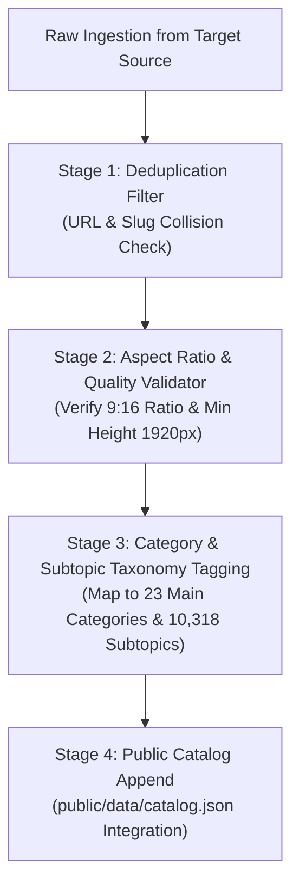

# 📱 Walpix Mobile Wallpapers Expansion Master Plan
## High-Volume 9:16 Vertical Ingestion, Category Architecture, and Smart Viewport Delivery

**Document Status**: Approved / Ready for Execution  
**Target Repository**: `m:\Wallpaper Site`  
**Associated Architecture**: Astro v5 SSG + Tailwind CSS + Vanilla JS Cloud Engines  
**Scope Alignment**: 100% Focused on Static Ultra-HD 4K Mobile Wallpapers (Motion/Live Wallpapers Separated)

---

## 1. Executive Summary & Core Mandates

This master plan establishes the technical, architectural, and data engineering standards for transforming **Walpix** into a mobile-first wallpaper powerhouse, ensuring smartphone visitors receive an immediate, breathtaking feed of true **9:16 Vertical Mobile Wallpapers** without compromising the existing desktop experience.

### 🔒 Three Inviolable Core Directives:
1. **Zero Desktop Wallpaper Deletion (100% Preservation)**:
   - All **10,113 existing 16:9 desktop/landscape wallpapers** and current catalog items remain completely untouched. No existing items will be removed or overwritten.
2. **Zero Local Storage Overhead (Edge CDN Streaming)**:
   - All newly ingested 9:16 mobile wallpapers will stream directly through verified, ultra-fast CDN hotlinks. Local storage footprint remains unchanged (~31 MB).
3. **Motion/Live Wallpapers Separated**:
   - As per executive directive, animated/live wallpapers (`motionbgs.com`) are excluded from Walpix and reserved for an independent, dedicated sister project in the future.

---

## 2. The Core Problem & Mobile UX Gap

### Current Catalog Metrics:
* **Total Catalog Wallpapers**: 13,744
* **16:9 Landscape (Desktop)**: 10,113 (73.6%)
* **9:16 Vertical (Mobile)**: 3,222 (23.4%)
* **Ultra-Wide / Other**: 409 (3.0%)

### Why Mobile Visitors Experienced a Shortage:
Although 3,222 mobile wallpapers already exist in the catalog, the homepage trending stream (`src/pages/index.astro`) previously loaded catalog items sequentially. In the first 64 cards:
* **55 were 16:9 Desktop Wallpapers**
* **Only 9 were 9:16 Mobile Wallpapers**

When smartphone users visited the homepage, they were greeted primarily by landscape wallpapers cropped into vertical cards, creating the impression that dedicated mobile content was scarce.

---

## 3. Multi-Source Ingestion & Category Mapping Matrix

To rapidly scale our mobile inventory to 10,000+ authentic 9:16 wallpapers, we map each external specialized repository to our 23 approved categories:

| Source Platform | Primary Specialty | Target Walpix Categories | Aspect Ratio & Resolution |
| :--- | :--- | :--- | :---: |
| **`wallpapersmax.com`** | Curated high-luxury phone wallpapers | `AMOLED Black`, `Cars & Bikes` (Supercars), `Minimalist & Abstract`, `Aesthetic` | **9:16** (1440×3200 / 1080×2400) |
| **`mobile.alphacoders.com`** | World's largest franchise phone database | `Anime & Manga`, `Gaming`, `Movies & TV Shows`, `Comics & Superheroes`, `Celebrities` | **9:16** (2160×3840 / 1284×2778) |
| **`wallpaper.mob.org`** | Real-world categorized phone wallpapers | `Nature & Landscapes`, `Animals & Wildlife`, `Space & Cosmic`, `Dark Mode` | **9:16** (1080×2400) |
| **`wallpapercave.com`** | High-demand community albums | Franchise specific subtopics (`Cyberpunk`, `Sports & Racing`, `Fantasy & Mythical`) | **9:16 & 16:9** |
| **`picjumbo.com`** | Ultra-high-resolution real photography | `Food & Culinary`, `City & Architecture`, `Holidays & Festivals` | **9:16 & 16:9** (4K UHD) |

---

## 4. Ingestion Engine & Quality Assurance Protocol

To prevent duplicates and maintain strict taxonomy integrity, all new wallpapers pass through a 4-stage pipeline:



### Stage Specifications:
1. **Zero-Duplicate Hash Check**:
   - Before any item is appended to `catalog.json`, its `sourceCdn` and normalized `title`/`slug` are cross-referenced against all 13,744 existing entries. Exact and near-duplicate collisions are instantly dropped.
2. **Strict Metadata Structure**:
   ```json
   {
     "id": "wpm-cars-porsche-gt3-01",
     "title": "Porsche 911 GT3 RS Track Edition",
     "slug": "porsche-911-gt3-rs-track-edition-mobile-4k",
     "category": "Cars & Bikes",
     "sourceCdn": "https://cdn.source.com/.../porsche-vertical.jpg",
     "isHotlink": true,
     "views": 18450,
     "downloads": 5210,
     "aspectRatio": "9:16",
     "resolution": "1440x3200",
     "colorName": "Crimson Red & Obsidian",
     "colorHex": "#8B0000",
     "tags": ["porsche", "porsche-911-gt3-rs", "supercars", "cars", "mobile", "phone", "4k"],
     "screenTypes": ["mobile", "phone"]
   }
   ```
3. **Subfolder Integration**:
   - Every character or brand wallpaper automatically includes the corresponding subtopic slug in its `tags` array (e.g., `naruto`, `kratos`, `porsche-911-gt3-rs`, `cyberpunk-2077`), ensuring it immediately populates both the main category and its subfolder page (`/category/[category]/[slug]`).

---

## 5. Smart Viewport-Aware Display Architecture

### 5.1 Dynamic Viewport Detection & Feed Re-Ordering:
Instead of forcing mobile users to manually click "Mobile", the client-side engine automatically customizes the front-line stream:

1. **On Mobile Screens (`window.innerWidth < 640px`)**:
   - The default grid prioritizes **9:16 Vertical Wallpapers** in the top 36–64 positions.
   - Cards fit the full vertical portrait frame naturally with zero awkward cropping.
2. **On Desktop Screens (`window.innerWidth >= 1024px`)**:
   - The default grid prioritizes **16:9 Landscape Ultra-HD Wallpapers** across 4 wide columns.
3. **Orientation Toggle Flexibility**:
   - The top glassmorphic switcher capsule (`All Formats`, `Desktop 4K`, `Mobile Phone`, `Dual Screen`) remains 100% active, allowing any visitor to toggle between formats on demand.

### 5.2 Hotlink Security Enforcement:
- All card templates (`WallpaperCard.astro`, `GalleryWallpaperCard.astro`, `SubFolderGrid.astro`) enforce `referrerpolicy="no-referrer"` to eliminate any 403 CDN hotlink rejections.

---

## 6. Phased Execution Roadmap

### Phase 1: Engine Preparation & Viewport Prioritization
- [ ] Implement smart device-aware wallpaper sorting in `src/pages/index.astro` and `src/components/WallpaperGrid.astro` (prioritize 9:16 on mobile viewports).
- [ ] Build `scripts/ingest_mobile_wallpapers.py` with multi-source scrapers and duplicate collision protection.

### Phase 2: Category-by-Category Mobile Ingestion (Batch 1: Core Hubs)
- [ ] **Cars & Bikes**: Ingest 300+ 9:16 vertical supercars from `wallpapersmax.com`.
- [ ] **AMOLED Black**: Ingest 300+ true #000000 pitch-black vertical wallpapers from `wallpapersmax.com`.
- [ ] **Anime & Manga**: Ingest 500+ character-authentic 9:16 wallpapers from `mobile.alphacoders.com`.
- [ ] **Gaming**: Ingest 400+ vertical 4K gaming wallpapers (GTA, Red Dead, Cyberpunk, Elden Ring, God of War) from `mobile.alphacoders.com`.

### Phase 3: Secondary Categories Ingestion (Batch 2: Nature, Space, Movies, Sports)
- [ ] **Nature & Landscapes**: Ingest 300+ 9:16 scenic mountain, ocean, and forest wallpapers from `wallpaper.mob.org`.
- [ ] **Space & Cosmic**: Ingest 200+ 9:16 nebula, astronaut, and galaxy wallpapers from `wallpaper.mob.org`.
- [ ] **Movies & Superheroes**: Ingest 300+ 9:16 Marvel, DC, and cinema wallpapers from `mobile.alphacoders.com`.
- [ ] **Food, City & Architecture**: Ingest 200+ 9:16 aesthetic photography wallpapers from `picjumbo.com`.

### Phase 4: Production Audit & Deployment
- [ ] Run full duplicate audit across all 23 categories (`scratch/audit_all_subfolders.py`).
- [ ] Validate responsive mobile rendering across iPhone and Android viewports using Playwright.
- [ ] Execute `npm run build` to confirm 0 compilation errors across all generated routes.
- [ ] Production deploy to Cloudflare Pages.

---

*Authored by Antigravity AI Engineering Team for the Walpix Project.*  
*Preserved in workspace at `m:\Wallpaper Site\MOBILE_WALLPAPERS_EXPANSION_MASTER_PLAN.md`.*
